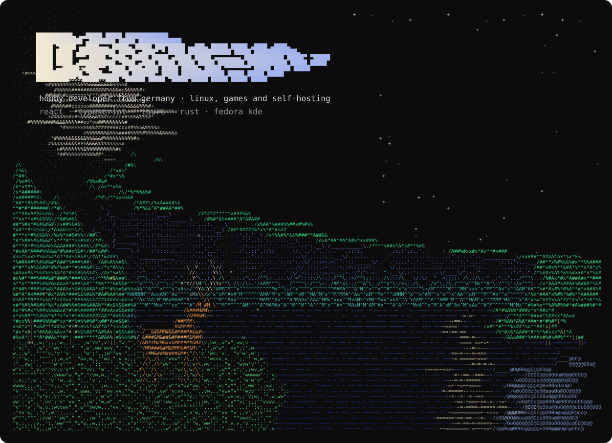
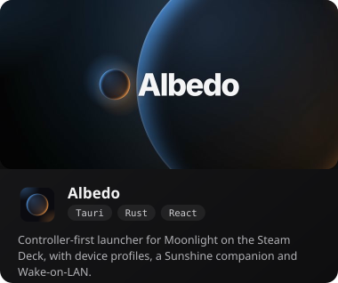
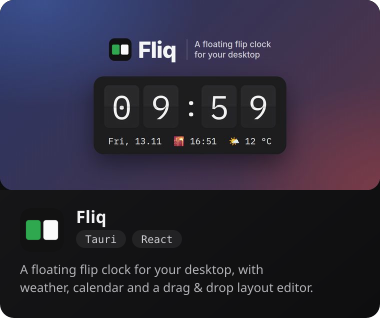
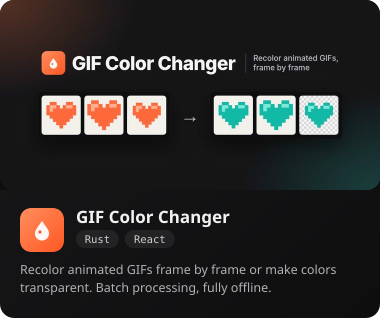
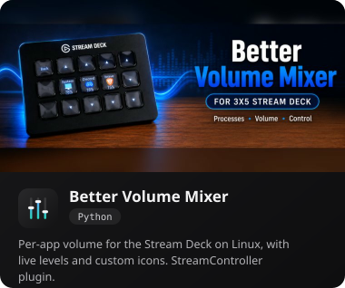

  

  
  
  
  

  Also added GIF support to <a href="https://github.com/StreamController/StreamController">StreamController</a> and its <a href="https://github.com/gensyn/HomeAssistantPlugin">Home Assistant plugin</a>.

  

